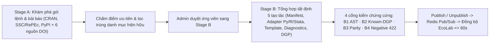

# Quản trị dữ liệu, pipeline và kiểm duyệt mô hình kinh tế lượng 2 giai đoạn

Trang này dành cho quản trị viên (Admin) hoặc kỹ sư vận hành EcoData. Người dùng phổ thông không cần thao tác các bước này khi tra cứu chỉ tiêu hoặc chạy mô hình kinh tế lượng.

## Danh mục các phân hệ quản trị chính

| Phân hệ quản trị | Đường dẫn / Giao thức | Vai trò vận hành |
| --- | --- | --- |
| **Admin Dashboard** | `/admin` | Giám sát sức khỏe hệ thống, hạn ngạch thành viên, thanh toán và tiến trình nền. |
| **Econometrics Model Curation** | `/admin/econometrics-curation` & `admin_econometrics_*` | Đường ống 2 giai đoạn phát hiện, tổng hợp 5 tạo tác, kiểm chứng 4 cổng `B1–B4` và xuất bản/thu hồi mô hình kinh tế lượng động. |
| **GSO & 34-Province Admin** | `/admin` (GSO tab) | Thu thập dữ liệu Cục Thống kê, quản lý bí danh chỉ tiêu và đối soát chuỗi chuẩn hóa 34 tỉnh. |
| **Customs & Commodity Admin** | `/admin` (Customs tab) | Quản lý lô báo cáo 11 biểu mẫu Hải quan và 5 nhóm ngành Thị trường Hàng hóa. |
| **Stock & Financials Admin** | `/admin` (Stocks tab) | Đồng bộ BCTC 30 năm theo 4 chế độ kế toán, thuyết minh, cổ tức và lịch sự kiện doanh nghiệp. |
| **Translation & Metadata Jobs** | `/admin` (Translation tab) | Dịch và kiểm chuẩn song ngữ VI/EN cho nhãn biến, định nghĩa và siêu dữ liệu SDMX. |
| **Chat Providers & Export Queue** | `/admin` | Cấu hình nhà cung cấp AI cho Web Chat và giám sát hàng đợi xuất dữ liệu quy mô lớn. |

---

## Đường ống quản trị phát hiện & đăng ký mô hình kinh tế lượng 2 giai đoạn

Để giữ danh mục **201+ bộ ước lượng thuộc 15 họ mô hình** luôn cập nhật các phương pháp kinh tế lượng mới mà không bao giờ đưa mã giả lập vào môi trường sản xuất, EcoData tách biệt nghiêm ngặt khâu **Khám phá học thuật (Stage A)** và khâu **Tổng hợp & Kiểm chứng thực thi 3 động cơ (Stage B)** tại `/admin/econometrics-curation` (`/api/admin/econometrics/*`).

### 1. Giai đoạn A — Khám phá chế độ kép và chính sách khóa API lai (Hybrid API Key Policy)

- **Nguồn chỉ mục gói lệnh & học thuật:** Quét trực tiếp siêu dữ liệu gói lệnh từ **CRAN `PACKAGES.gz`** (Task View Econometrics), **Stata SSC / RePEc** và **PyPI**, kết hợp kiểm chứng trích dẫn từ 6 cơ sở dữ liệu học thuật (**OpenAlex**, **Crossref**, **DOAJ**, **arXiv**, **Semantic Scholar**, **CORE**).
- **Chính sách khóa API lai 100% không phụ thuộc khóa bắt buộc:**
  - **Mặc định không cần khóa (Keyless-First):** Stage A vận hành đầy đủ trên CRAN, Stata SSC/RePEc, PyPI, OpenAlex, Crossref, DOAJ và arXiv mà không yêu cầu bất kỳ khóa API nào.
  - **Khóa tăng tốc học thuật tùy chọn:** Admin có thể lưu khóa **Semantic Scholar** và **CORE** được mã hóa **Fernet** trong cấu hình quản trị để mở rộng hạn mức truy vấn bài báo.
  - **Không cần khóa LLM cho Stage B:** Khâu tổng hợp bộ khung 5 tạo tác ở Stage B sử dụng kỹ thuật phân tích cây cú pháp AST và nội soi chữ ký hàm (`inspect` / `formals`) hoàn toàn tất định; khóa LLM của Admin trên Web UI chỉ là tùy chọn làm mượt mô tả tài liệu song ngữ, trong khi toàn bộ luồng `/mcp*` giữ bất biến **`server_llm_calls == 0`**.

### 2. Giai đoạn B — Năm tạo tác bắt buộc và bốn cổng kiểm chứng cứng (`B1–B4`)

Mỗi ứng viên mô hình chuyển sang Stage B phải có đủ **5 tạo tác bắt buộc**:
1. **Manifest Schema:** Định danh `estimator_key`, họ mô hình, yêu cầu biến phụ thuộc/nội sinh/công cụ/cụm và từ điển nhãn song ngữ VI/EN.
2. **Tri-Engine Execution Adapters:** Hàm thực thi thật trên **Python**, **R (RMCP)** và **Stata 18 MP** (lưu gói `.ado` bền vững kèm khóa băm SHA-256).
3. **Replication Script Templates:** Khuôn mẫu sinh mã tái lập `.py`, `.R`, `.do` đóng gói trong `.zip` (`SHA256SUMS.txt`).
4. **Pre/Postestimation Diagnostic Hooks:** Liên kết bộ kiểm định tiền ước lượng và hậu ước lượng đặc thù của phương pháp.
5. **Synthetic Known-DGP Benchmark Fixture:** Bộ sinh dữ liệu kiểm chuẩn có tham số gốc đã biết trước.

Nút **`Publish`** trên giao diện quản trị và API bị khóa cứng ở mức phần mềm cho đến khi ứng viên vượt qua toàn bộ **4 cổng kiểm chứng thực tế**:

| Mã cổng | Tên cổng kiểm chứng | Tiêu chí đạt bắt buộc |
| --- | --- | --- |
| **`B1`** | **AST & Command Safety Guard** | Cấm tuyệt đối các lệnh hệ thống/mạng/tệp nguy hiểm trong mã Python AST, biểu thức R và kịch bản Stata `.do`. |
| **`B2`** | **Known-DGP Parameter Recovery** | Chạy thật trên dữ liệu DGP chuẩn có kích thước mẫu cố định, xác nhận hệ số ước lượng hội tụ đúng về tham số thật trong ngưỡng dung sai toán học. |
| **`B3`** | **Cross-Engine Numerical Parity** | Đối soát chéo kết quả giữa Python, R và Stata 18 MP đảm bảo đồng thuận dấu, bậc độ lớn và sai số chuẩn theo chuẩn phương pháp. |
| **`B4`** | **Negative `422` Fail-Closed Contract** | Kiểm chứng dữ liệu suy biến hoặc thiếu biến bắt buộc phải trả về đúng mã `422` có cấu trúc, tuyệt đối không fallback ngầm về OLS hay gây lỗi `500`. |

### 3. Năm công cụ Admin MCP và đồng bộ nóng `<= 60s` sang EcoLab

Quản trị viên có thể điều khiển toàn bộ vòng đời ngay từ trợ lý AI qua 5 công cụ Admin MCP (chỉ hiển thị cho tài khoản Admin):
- `admin_econometrics_discover_start`: Khởi chạy tiến trình khám phá Stage A theo chủ đề hoặc họ mô hình.
- `admin_econometrics_candidates_list`: Truy vấn danh sách ứng viên, điểm ưu tiên và trạng thái kiểm chứng `B1–B4`.
- `admin_econometrics_verify_candidate`: Kích hoạt kiểm định thực tế 4 cổng `B1–B4` trên bộ 3 động cơ.
- `admin_econometrics_publish_model`: Xuất bản mô hình đã đạt `4/4` cổng vào danh mục trực tuyến.
- `admin_econometrics_unpublish_model`: Thu hồi an toàn mô hình khỏi danh mục công khai (giữ nguyên khả năng đọc các gói kết quả lịch sử).

Ngay khi Admin bấm **`Publish`** hoặc **`Unpublish`**, EcoData phát tín hiệu qua Redis Pub/Sub, nâng `catalog_version` tại `GET /api/catalog/manifest` và dịch vụ `CatalogHeartbeatService` của **EcoLab** tự động cập nhật cây mô hình cùng danh sách công cụ Unified MCP trong vòng **`<= 60` giây** mà không cần khởi động lại bất kỳ container nào.

---

## Nguyên tắc vận hành an toàn trên hạ tầng chia sẻ

1. Không bỏ qua tầng dịch vụ kiểm chứng `B1–B4` khi đăng ký bộ ước lượng mới.
2. Luôn tạo bản sao lưu cơ sở dữ liệu (`pg_dump` phân quyền `0600`) trước mọi thay đổi cấu trúc.
3. Trên máy chủ VPS dùng chung nhiều ứng dụng, luôn kiểm tra cổng mạng loopback `127.0.0.1`, Nginx và trạng thái container trước khi triển khai; tuyệt đối không chạy `docker compose down`.
4. Kiểm tra smoke test đầy đủ trên cả giao diện Web, `/api/catalog/manifest`, EcoLab và cổng Unified MCP sau mỗi đợt cập nhật.
