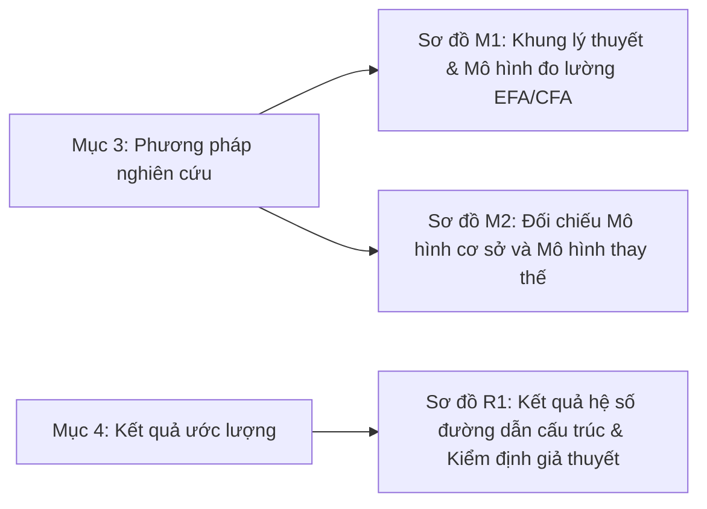

# Hướng dẫn từng bước: Phân tích EFA/CFA/SEM/PLS-SEM, Bộ 3 Sơ đồ Cấu trúc 300-DPI và Siêu liên kết Trích dẫn Hai chiều

Trang này hướng dẫn chi tiết từng bước cách thực hiện nghiên cứu định lượng với thang đo tâm trắc học (**EFA / CFA / SEM / PLS-SEM**), cách khai thác **Bộ 3 sơ đồ mô hình đo lường & cấu trúc chuẩn học thuật 300-DPI**, và cách sử dụng **Siêu liên kết trích dẫn hai chiều** cùng nút **Lên đầu trang** khi đọc và xuất bản báo cáo trên **EcoLab** và **EcoData**.

---

## 1. Bộ 3 sơ đồ mô hình đo lường & cấu trúc chuẩn học thuật (300 DPI)

Trong mọi nghiên cứu sử dụng phân tích nhân tố khám phá (**EFA**), phân tích nhân tố khẳng định (**CFA**), mô hình phương trình cấu trúc (**CB-SEM**) hoặc bình phương tối thiểu từng phần (**PLS-SEM**), hệ thống tự động khởi tạo và chèn **3 sơ đồ 300-DPI** vào đúng hai vị trí chuẩn mực của bài báo quốc tế:

### Sơ đồ M1 (Mục 3 — Phương pháp nghiên cứu): Khung lý thuyết & Mô hình đo lường EFA/CFA
- **Cách đọc sơ đồ:**
  - Các **khối chữ nhật (`X1..Xk`)** biểu diễn các biến quan sát Likert của từng thang đo kèm khoảng hệ số tải ngoài $\lambda$.
  - Các **khối elip** biểu diễn các nhân tố tiềm ẩn độc lập, trung gian, điều tiết và phụ thuộc.
  - Các **mũi tên liền nét (`H1..Hk`)** thể hiện chiều tác động kỳ vọng của từng giả thuyết nghiên cứu trước khi ước lượng.

### Sơ đồ M2 (Mục 3 — Phương pháp nghiên cứu): Đối chiếu Mô hình cấu trúc cơ sở và Mô hình thay thế
- **Cách đọc sơ đồ:**
  - **Khung A (Bên trái — Mô hình cơ sở):** Trình bày đặc tả tác động trực tiếp giữa các thang đo chính.
  - **Khung B (Bên phải — Mô hình mở rộng / đối chứng):** Trình bày đặc tả có biến trung gian, biến tương tác điều tiết ($X 	imes W$) hoặc ước lượng vững phân vị ($	au = 0.50$) để người đọc nắm rõ chiến lược kiểm định độ vững.

### Sơ đồ R1 (Mục 4 — Kết quả ước lượng): Sơ đồ đường dẫn cấu trúc kèm hệ số thực tế
- **Cách đọc sơ đồ:**
  - Trên mỗi nhánh quan hệ hiển thị trực tiếp **hệ số ước lượng mô hình cơ sở ($\hat{eta}_{	ext{base}}$)**, **hệ số mô hình thay thế ($\hat{eta}_{	ext{alt}}$)**, **mức ý nghĩa thống kê (`***`, `**`, `*`, `ns`)** và **sai số chuẩn (`SE`)**.
  - Nhánh giả thuyết được chấp nhận hiển thị bằng **đường liền nét đậm**; nhánh không có ý nghĩa thống kê hiển thị bằng **đường nét đứt**.
  - Bên trong khối elip của biến phụ thuộc hiển thị rõ **hệ số xác định $R^2$**, **$R^2$ hiệu chỉnh**, **thống kê $F$** và **cỡ mẫu $N$**.

---

## 2. Hướng dẫn sử dụng Siêu liên kết trích dẫn hai chiều (Bidirectional Citations)

Để giúp người đọc, giảng viên hướng dẫn và phản biện viên kiểm tra nhanh nguồn học thuật mà không bị mất mạch đọc, mọi báo cáo và bài viết trên chuyên mục Blog nghiên cứu đều tích hợp **Siêu liên kết trích dẫn hai chiều**:

1. **Bước 1 — Nhấn vào trích dẫn trong bài viết:**
   - Khi đang đọc ở Mục 1, 2, 3, 4 hoặc 5, bạn có thể nhấn trực tiếp vào bất kỳ trích dẫn nào như `(Hair et al., 2022)` hoặc `Fornell & Larcker (1981)`.
   - Trang sẽ tự động cuộn mượt xuống đúng dòng tài liệu tương ứng tại **Mục 6 (Tài liệu tham khảo)** và làm nổi bật tài liệu đó bằng hiệu ứng sáng màu vàng kim trong 3 giây.
2. **Bước 2 — Mở bài báo gốc qua liên kết DOI:**
   - Tại dòng tài liệu tham khảo vừa được làm nổi bật, bạn có thể nhấn vào liên kết `https://doi.org/...` để mở trực tiếp trang công bố quốc tế của bài báo gốc.
3. **Bước 3 — Quay lại đúng vị trí đang đọc chỉ với 1 chạm:**
   - Ngay cạnh tài liệu tham khảo tại Mục 6 có nút **`↩ Quay lại vị trí đọc`**.
   - Khi nhấn vào nút này, hệ thống sẽ đưa bạn trở lại chính xác đoạn văn và câu trích dẫn mà bạn vừa rời đi, đồng thời làm nổi bật nhẹ câu trích dẫn đó để bạn tiếp tục đọc liền mạch.

---

## 3. Nút Lên đầu trang kèm Vòng tròn tiến độ đọc và Tải gói tái lập

- **Nút Lên đầu trang thông minh (`Back to Top`):** Khi bạn cuộn xuống quá phần mở đầu của báo cáo hoặc bài viết, nút tròn ở góc dưới bên phải sẽ xuất hiện cùng **vòng tròn hiển thị phần trăm tiến độ đọc (`0% – 100%`)**. Nhấn vào nút để cuộn mượt về đầu trang bất cứ lúc nào.
- **Tải dữ liệu `.csv` và chuyển đổi mã lệnh `R / Stata / Python` trên di động:** Tại phần **Phụ lục**, bạn có thể tải trực tiếp tệp dữ liệu `.csv` chuẩn UTF-8 và chuyển đổi nhanh giữa 3 ngôn ngữ **R**, **Stata**, **Python** trên một hàng nút gọn gàng ngay cả trên màn hình điện thoại nhỏ.
