import Head from '@docusaurus/Head';

export const methodSchema = {
  '@context': 'https://schema.org',
  '@type': 'TechArticle',
  '@id': 'https://docs.tnsai.vn/ecodata/du-lieu/methodology#article',
  headline: 'Phương pháp luận dữ liệu EcoData và thuật toán chuẩn hóa địa giới 34 tỉnh thành Việt Nam 1995–2026',
  description:
    'Mô tả minh bạch quy trình thu thập, làm sạch, chuẩn hóa mã ngắn học thuật, xử lý 3 mốc lịch sử địa giới hành chính 1995–2003, 2003–2008 và 2025 theo 5 quy tắc kinh tế lượng, và kiểm soát chất lượng trên EcoData.',
  url: 'https://docs.tnsai.vn/ecodata/du-lieu/methodology',
  inLanguage: ['vi', 'en'],
  author: { '@type': 'Organization', name: 'EcoData', url: 'https://ecodata.io.vn/' },
  publisher: { '@type': 'Organization', name: 'EcoData', url: 'https://ecodata.io.vn/' },
  about: [
    'data aggregation',
    'data cleaning',
    'Vietnam 63-to-34 provincial boundary harmonization',
    'SDMX metadata',
    'scientific reproducibility',
  ],
};

<Head>
  
</Head>

# Phương pháp luận dữ liệu và chuẩn hóa 34 tỉnh thành

EcoData không tự tạo ra số liệu sơ cấp. Vai trò của nền tảng là **tổng hợp, làm sạch, chuẩn hóa không gian – thời gian và gán siêu dữ liệu** từ các nguồn chính thức về một định dạng dữ liệu bảng và chuỗi thời gian thống nhất, sẵn sàng cho ước lượng kinh tế lượng và công bố quốc tế.

## Quy trình xử lý dữ liệu tổng thể

```mermaid
flowchart LR
  A["Nguồn chính thức WB, IMF, NSO, FISCAL, Hải quan"] --> B["Thu thập qua API, SDMX và trích xuất có kiểm soát"]
  B --> C["Làm sạch, khử trùng lặp và chuẩn hóa kiểu dữ liệu"]
  C --> D["Chuẩn hóa 3 mốc địa giới 1995-2003, 2003-2008, 2025"]
  D --> E["Ánh xạ mã ngắn học thuật ss_dom_key_mod"]
  E --> F["Kiểm soát chất lượng, đối soát PLV01..PLV14 và dịch song ngữ"]
  F --> G["Lưu trữ song song bảng 63 tỉnh và 34 tỉnh"]
  G --> H["Xem trước, xuất dữ liệu và truy xuất qua 37 công cụ MCP"]
```

## 1. Thu thập dữ liệu đa nguồn và 7 phân hệ Finco

EcoData vận hành các đường ống thu thập chuyên biệt theo từng loại nguồn:
- **API quốc tế chuẩn hóa:** Giao thức SDMX v2/v3 cho IMF, Eurostat, OECD, ILO; giao thức REST cho World Bank, FAO, OWID, FRED, WTO, UNCTAD và ADB; cùng phân hệ **`MAIN_MARKET`** bao phủ 8 khu vực kinh tế trọng điểm.
- **Bảy phân hệ dữ liệu Việt Nam chuyên sâu:**
  - **`NSO`:** 28 bảng dữ liệu PX-Web cấp tỉnh và Phụ lục Niên giám 2024 theo 34 tỉnh thành mã `PLV01..PLV14`.
  - **`FISCAL`:** Chuỗi quyết toán và dự toán ngân sách nhà nước của Bộ Tài chính mã `THUCHINS` giai đoạn 1995–2026.
  - **`KTXH_GSO`:** Báo cáo kinh tế – xã hội định kỳ tháng, quý và năm giai đoạn 2000–2026.
  - **`CUSTOMS`:** 11 biểu mẫu thống kê xuất nhập khẩu chính thức của Cục Hải quan gồm `1X`, `1N`, `2X`, `2N`, `3X`, `3N`, `4`, `5X`, `5N`, `HTX` và `PTVT`.
  - **`SURVEY_INDEX`:** 7 bộ chỉ số quản trị và thể chế cấp tỉnh gồm `PCI`, `PGI`, `PAPI`, `PII`, `ICT Index`, `PAR Index` và `SIPAS`.
  - **`COMMODITY_MARKET`:** Dữ liệu sản lượng, thương mại và giá cả của 5 nhóm ngành hàng hóa qua 5 chiều phân tích.
  - **`VN_34_REBUILD`:** Động cơ tái cấu trúc chuỗi lịch sử 34 tỉnh thành giai đoạn 2000–2026.
- **Dữ liệu vi mô và thị trường vốn:** Điều tra mức sống dân cư VHLSS theo kỳ khảo sát và báo cáo tài chính 30 năm của hơn 1.600 doanh nghiệp niêm yết theo 4 chế độ kế toán Việt Nam.

## 2. Phương pháp luận xử lý ba mốc lịch sử địa giới hành chính Việt Nam 1995–2026

Để giải quyết bài toán đứt gãy chuỗi dữ liệu cấp tỉnh mà không làm mất giá trị lịch sử gốc, EcoData áp dụng nguyên tắc **không ghi đè bảng 63 tỉnh**: mọi bảng dữ liệu gốc 63 tỉnh được giữ nguyên 100%, trong khi chuỗi chuẩn hóa 34 tỉnh được tính toán độc lập và lưu tại bảng `vn_province_34_series` dựa trên bảng ánh xạ `vn_admin_units_34`.

### Xử lý mốc 1995–2003 theo Nghị quyết 22/2003/QH11

Từ ngày 01/01/2004, Lai Châu tách thành Lai Châu và Điện Biên; Đắk Lắk tách thành Đắk Lắk và Đắk Nông; Cần Thơ tách thành TP. Cần Thơ và tỉnh Hậu Giang:
- **Ở chế độ 63 tỉnh:** Hệ thống ước lượng lùi chuỗi 1995–2003 bằng tỷ trọng thực nghiệm bình quân 3 năm liền kề sau chia tách 2004–2006 của từng tỉnh mới đối với từng chỉ tiêu cụ thể.
- **Ở chế độ 34 tỉnh:** Do TP. Cần Thơ và tỉnh Hậu Giang cùng tỉnh Sóc Trăng hợp nhất thành TP. Cần Thơ mới theo Nghị quyết 202/2025/QH15, giá trị lịch sử giai đoạn 1995–2003 của cụm này được cộng gộp trực tiếp chính xác mà không cần tách ước lượng; tương tự với Đắk Lắk và Đắk Nông trong các bảng tổng hợp vùng. Riêng **Điện Biên** và **Lai Châu** vẫn là hai tỉnh độc lập trong danh mục 34 tỉnh thành mới nên tiếp tục sử dụng tỷ trọng thực nghiệm 2004–2006 để phân tách giai đoạn trước năm 2004.

### Xử lý mốc 2003–2008 theo Nghị quyết 15/2008/QH12

Từ ngày 01/08/2008, toàn bộ tỉnh Hà Tây, huyện Mê Linh thuộc tỉnh Vĩnh Phúc và 4 xã thuộc huyện Lương Sơn, tỉnh Hòa Bình sáp nhập vào TP. Hà Nội:
- **Phát hiện chuỗi đã tính lùi:** Hệ thống kiểm tra tự động xem chỉ tiêu của Hà Nội giai đoạn trước năm 2008 đã được Cục Thống kê điều chỉnh gộp Hà Tây sẵn hay chưa. Nếu đã tính lùi, hệ thống giữ nguyên số liệu chính thức của Hà Nội mở rộng và loại bỏ dòng Hà Tây trùng lặp để ngăn chặn tuyệt đối lỗi tính hai lần.
- **Cộng gộp có gắn cờ siêu dữ liệu:** Nếu bảng nguồn trước năm 2008 công bố tách biệt Hà Nội cũ và Hà Tây, hệ thống gộp toàn bộ tỉnh Hà Tây vào Hà Nội và gắn cờ siêu dữ liệu ghi nhận giới hạn không bóc tách cấp huyện đối với huyện Mê Linh và 4 xã thuộc huyện Lương Sơn.

### Xử lý mốc 2025 theo Nghị quyết 202/2025/QH15 và năm quy tắc toán học

Từ ngày 01/07/2025, 63 tỉnh thành được sắp xếp thành **34 tỉnh, thành phố** gồm 11 đơn vị giữ nguyên địa giới và 23 đơn vị hợp nhất từ 2 đến 3 tỉnh cũ. EcoData áp dụng **5 quy tắc toán học** tùy theo bản chất kinh tế của từng biến số:

| Mã quy tắc | Công thức toán học | Nhóm biến số áp dụng |
| --- | --- | --- |
| **`sum`** | $Y_{P,t} = \sum_{i \in P} Y_{i,t}$ | Diện tích tự nhiên, dân số trung bình, lực lượng lao động, GRDP giá hiện hành, GRDP giá so sánh, tổng thu chi ngân sách `THUCHINS`, vốn đầu tư thực hiện, kim ngạch xuất nhập khẩu. |
| **`weighted_mean`** | $R_{P,t} = \frac{\sum_{i \in P} R_{i,t} W_{i,t}}{\sum_{i \in P} W_{i,t}}$ | GRDP bình quân đầu người, thu nhập bình quân tháng, mật độ dân số, tỷ lệ hộ nghèo, tỷ lệ thất nghiệp, tỷ lệ đô thị hóa với quyền số $W_{i,t}$ là dân số, diện tích hoặc lao động tương ứng. |
| **`growth_constant_scale`** | $g_{P,t} = \left(\frac{\sum_{i \in P} Q_{i,t}}{\sum_{i \in P} Q_{i,t-1}} - 1\right) \times 100$ | Tốc độ tăng trưởng GRDP, tốc độ tăng giá trị sản xuất nông – lâm – thủy sản, công nghiệp – xây dựng và dịch vụ tính từ quy mô giá so sánh $Q_{i,t}$. |
| **`index_chain`** | $I_{P,t} = \frac{\sum_{i \in P} I_{i,t} S_{i,t-1}}{\sum_{i \in P} S_{i,t-1}}$ | Chỉ số giá tiêu dùng CPI và chỉ số sản xuất công nghiệp IIP gia quyền theo quy mô bán lẻ hàng hóa dịch vụ hoặc giá trị tăng thêm công nghiệp $S_{i,t-1}$. |
| **`non_aggregable`** | Giữ nguyên quan sát gốc kèm khóa ánh xạ 34 tỉnh | Các chỉ số khảo sát cảm nhận quản trị thể chế trước tháng 07/2025 như PCI, PAPI, PAR Index, SIPAS và bản ghi điều tra vi mô hộ gia đình VHLSS. |

Toàn bộ chuỗi tái cấu trúc 34 tỉnh được đối soát tự động với Phụ lục NSO `PLV01..PLV14` và Báo cáo KTXH 2025–2026, bảo đảm **độ khớp từ 99,5% trở lên**.

## 3. Chuẩn hóa mã ngắn học thuật và kiểm soát chất lượng

- **Hệ thống mã học thuật `ss_dom_key_mod`:** Mọi chỉ tiêu đều được gán mã ngắn tối đa 18 ký tự không dấu, chữ thường, ngăn cách bằng dấu gạch dưới như `wb_mac_gdp_usd`, đồng thời tự động sinh nhãn ký hiệu toán học LaTeX 3 tầng khi đưa vào mô hình kinh tế lượng.
- **Chú thích nguồn dữ liệu gốc thu gọn:** Mỗi bảng dữ liệu đều đính kèm thông tin nguồn gốc chi tiết đặt trong khung thu gọn ở cuối màn hình, hiển thị rõ mã nguồn như `NSO`, `FISCAL`, `CUSTOMS`, `GSO`, đơn vị gốc và quy tắc chuẩn hóa.
- **Song ngữ Việt – Anh có kiểm chứng:** Toàn bộ nhãn chỉ tiêu và đơn vị đo được chuẩn hóa song ngữ qua đường ống dịch thuật học thuật có kiểm soát chất lượng.

## 4. Tái lập khoa học và trích dẫn

Mỗi tệp dữ liệu xuất ra từ EcoData luôn đi kèm trang **Metadata** ghi rõ mã ngắn học thuật, định nghĩa, đơn vị đo, cơ quan ban hành và chế độ địa giới 63 tỉnh hoặc 34 tỉnh. Khi kết hợp với công cụ [Kinh tế lượng](/ecodata/cong-cu/econometrics) hoặc `run_complete_econometric_study` qua MCP, nhà nghiên cứu nhận trọn bộ kịch bản `.do`, `.R` và `.py` để tái lập 100% kết quả thực nghiệm.

## Xem thêm

- [Từ điển dữ liệu](/ecodata/du-lieu/data-dictionary)
- [Thống kê GSO, NSO và dữ liệu 34 tỉnh thành Việt Nam](/ecodata/indicators/gso-vietnam)
- [Phân nhóm nguồn dữ liệu và 7 phân hệ chuyên sâu](/ecodata/nguon-du-lieu/phan-nhom-nguon-du-lieu)
