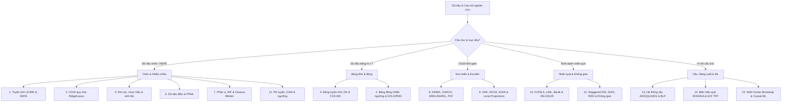
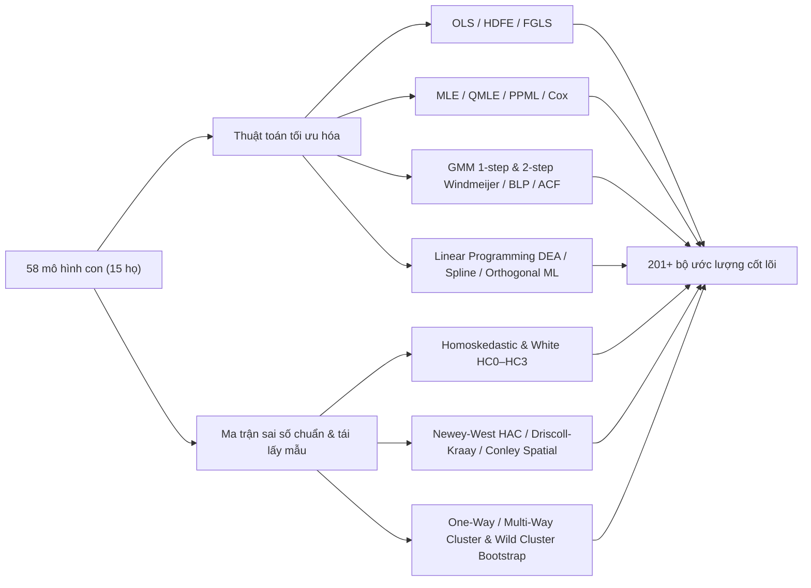

# Danh mục 15 họ mô hình, 58 mô hình con & 201+ bộ ước lượng

EcoData (`v3.82.0`) và EcoLab (`v1.5.0`) tích hợp động cơ kinh tế lượng thống nhất gồm **15 họ mô hình lớn**, phân rã thành **58 mô hình con** và **201+ bộ ước lượng cốt lõi (estimators)** thực thi thật trên **Python**, **R** và **Stata 18 MP**. Trang này đóng vai trò bản đồ phương pháp luận giúp bạn chọn chính xác họ mô hình theo cấu trúc dữ liệu và chiến lược định danh.

:::tip Kiểm chứng thực nghiệm và xuất gói tái lập 100%
Mọi bộ ước lượng trong danh mục đều thực thi đúng thuật toán gốc (cam kết Fail-Closed `422`, không bao giờ fallback ngầm sang OLS) và xuất gói mã tái lập `.zip` gồm kịch bản Stata 18 MP (`.do`), R (`.R`), Python (`.py`) kèm tệp băm `SHA256SUMS.txt`.
:::

---

## Bản đồ quyết định 15 họ mô hình

---

## Bảng phân loại 15 họ mô hình → 58 mô hình con

| # | Họ mô hình | Mô hình con tiêu biểu | Khi nào ưu tiên sử dụng |
| :--- | :--- | :--- | :--- |
| 1 | **Hồi quy tuyến tính cổ điển & HDFE** | [OLS](/ecolab/model/ols), [WLS](/ecolab/model/wls), [GLS](/ecolab/model/gls), [TLS](/ecolab/model/tls), Multi-Way HDFE | Quan hệ tuyến tính cơ sở hoặc hấp thụ tác động cố định đa chiều quy mô lớn |
| 2 | **Hồi quy chính quy hóa** | [Ridge](/ecolab/model/ridge), [Lasso](/ecolab/model/lasso), [Elastic Net](/ecolab/model/elastic-net), [Adaptive Lasso](/ecolab/model/adaptive-lasso), Post-Lasso | Dữ liệu nhiều biến dự báo, đa cộng tuyến nghiêm trọng, chọn lọc biến |
| 3 | **Dữ liệu bảng tuyến tính** | [Pooled OLS](/ecolab/model/pooled-ols), [Fixed/Random Effects](/ecolab/model/fem-rem), [Between](/ecolab/model/between), Mundlak CRE, Driscoll-Kraay, CCE-MG, PCSE | Dữ liệu bảng nhiều đơn vị × nhiều kỳ, kiểm soát bất đồng nhất không quan sát được và phụ thuộc chéo |
| 4 | **Bảng động, ngưỡng & đồng liên kết** | [Difference & System GMM](/ecolab/model/gmm), Dynamic Panel Threshold, Panel DOLS, FMOLS, PMG | Có biến phụ thuộc trễ, nội sinh động ($N$ lớn $T$ nhỏ) hoặc bảng vĩ mô đồng liên kết $T$ lớn |
| 5 | **Biến phụ thuộc giới hạn & sinh tồn** | [Logit](/ecolab/model/logit), [Probit](/ecolab/model/probit), [Tobit](/ecolab/model/tobit), [Truncated](/ecolab/model/truncated), [Heckman](/ecolab/model/heckman), Fractional, Cox PH, Weibull AFT | Biến nhị phân, đa lựa chọn, tỷ trọng $[0, 1]$, bị chặn, chọn mẫu hoặc thời gian sự kiện |
| 6 | **Dữ liệu đếm & trọng lực PPML** | [Poisson](/ecolab/model/poisson), [Negative Binomial](/ecolab/model/negbin), [ZIP](/ecolab/model/zip), [ZINB](/ecolab/model/zinb), Gravity PPML-HDFE | Biến đếm nguyên không âm, bằng sáng chế và thương mại song phương có nhiều dòng bằng $0$ |
| 7 | **Hồi quy phân vị & phân rã** | [Linear Quantile](/ecolab/model/quantile), [Panel MM-QR](/ecolab/model/panel-quantile), RIF Quantile, Oaxaca-Blinder | Tác động khác biệt dọc phân phối và phân rã chênh lệch lương/năng suất |
| 8 | **Chuỗi thời gian đơn biến & chuyển chế độ** | [ARIMA](/ecolab/model/arima), [SARIMA](/ecolab/model/sarima), [GARCH](/ecolab/model/garch), [EGARCH](/ecolab/model/egarch), [ARDL](/ecolab/model/ardl), NARDL, Markov-Switching, PSY GSADF | Dự báo biến động, đồng liên kết hỗn hợp $I(0)/I(1)$, truyền dẫn bất đối xứng và kiểm định bong bóng |
| 9 | **Chuỗi thời gian đa biến & Local Projections** | [VAR](/ecolab/model/var), [VECM](/ecolab/model/vecm), [SVAR](/ecolab/model/svar), Jordà Local Projections, IV-LP, Panel VAR | Hệ nhiều chuỗi vĩ mô, cú sốc cấu trúc và hàm phản ứng đẩy IRF vững |
| 10 | **Biến công cụ & hệ phương trình** | [IV/2SLS](/ecolab/model/iv-2sls), LIML, Lewbel IV, Bartik Shift-Share, [3SLS](/ecolab/model/3sls), [SUR](/ecolab/model/sur) | Xử lý nội sinh, công cụ yếu, cú sốc ngành – vùng và hệ phương trình đồng thời |
| 11 | **Phi tuyến, bán tham số & ngưỡng** | [NLS](/ecolab/model/nls), [GAM](/ecolab/model/gam), Hansen Threshold, Robinson Semiparametric | Quan hệ cong phi tuyến chưa biết trước dạng hàm hoặc chia tách chế độ theo ngưỡng |
| 12 | **Suy luận nhân quả & không gian** | [TWFE & Staggered DID (CS, SA, BJS, SDID)](/ecolab/model/did), [PSM/AIPW](/ecolab/model/psm), [Sharp/Fuzzy RDD](/ecolab/model/rdd), Synthetic Control, Spatial SAR/SEM/SDM & Conley HAC | Đánh giá chính sách đa thời điểm, đối chứng tổng hợp, ngưỡng cắt và tương tác không gian |
| 13 | **Tổ chức ngành cấu trúc & hệ thống cầu** | [AIDS, QUAIDS, Berry Logit IV & Random-Coefficients BLP](/ecolab/model/demand-systems-blp) | Độ co giãn giá – thu nhập hệ thống cầu tiêu dùng và sức mạnh thị trường sản phẩm phân biệt |
| 14 | **Biên hiệu quả, năng suất & TFP** | [SFA, DEA, Malmquist, Olley-Pakes, Levinsohn-Petrin, Wooldridge & ACF TFP](/ecolab/model/frontier-tfp-decomposition) | Đo lường hiệu quả kỹ thuật ngân hàng/doanh nghiệp và năng suất nhân tố tổng hợp cấu trúc |
| 15 | **Tái lấy mẫu, học máy nhân quả & suy diễn nhiều chiều** | [Wild Cluster Bootstrap, Double/Debiased ML, Causal Forest & PCA/Factor](/ecolab/model/bootstrap-highdim-inference) | Suy diễn chuẩn xác khi số cụm ít ($G < 30$), kiểm soát nhiễu nhiều chiều và ước lượng CATE |

---

## 201+ bộ ước lượng được cấu thành như thế nào?

**58 mô hình con** đại diện cho các đặc tả cấu trúc riêng biệt. Khi kết hợp từng mô hình con với thuật toán tối ưu hóa chuẩn xác và ma trận hiệp phương sai sai số chuẩn chuyên dụng, hệ thống hình thành **201+ bộ ước lượng cốt lõi** (cùng khả năng mở rộng động qua đường ống quản trị 2 giai đoạn `B1–B4` trên EcoData):

---

## Ma trận tách bạch kiểm định tiền ước lượng và hậu ước lượng

| Giai đoạn | Kiểm định chẩn đoán tiêu biểu | Vai trò trong bài báo thực nghiệm |
| :--- | :--- | :--- |
| **Tiền ước lượng (Pre-Estimation)** | ADF, PP, KPSS, IPS, LLC, Pesaran CIPS; $VIF$; Pesaran CD; Moran's $I$; Pedroni, Kao, Westerlund, Johansen | Chứng minh tính dừng, kiểm tra đa cộng tuyến, xác nhận phụ thuộc chéo/không gian và đồng liên kết trước khi chọn mô hình |
| **Hậu ước lượng (Postestimation)** | Breusch-Pagan, White, Wooldridge, Ramsey RESET, Hausman/Mundlak, AR(1)/AR(2), Hansen $J$, Kleibergen-Paap rk Wald $F$, Bounds $F/t$, Event-Study Pre-Trend, McCrary | Xác nhận giả định phần dư, tính hợp lệ của biến công cụ, xu hướng song song và độ tin cậy của suy diễn thống kê |

---

## Xem thêm

- [Ước lượng & mô hình hóa kinh tế lượng](/ecolab/econometrics-modeling) — quy trình thực hiện chi tiết trên EcoLab
- Các họ mô hình mới mở rộng: [Hệ thống cầu & BLP (Họ 13)](/ecolab/model/demand-systems-blp) · [Biên hiệu quả & TFP (Họ 14)](/ecolab/model/frontier-tfp-decomposition) · [Wild Cluster Bootstrap & Causal ML (Họ 15)](/ecolab/model/bootstrap-highdim-inference)
- Các họ mô hình trọng điểm khác: [Dữ liệu bảng (FEM/REM)](/ecolab/model/fem-rem) · [Bảng động (GMM)](/ecolab/model/gmm) · [ARDL](/ecolab/model/ardl) · [VECM](/ecolab/model/vecm) · [DID](/ecolab/model/did)
