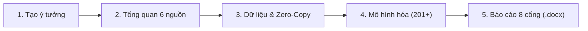

import McpPromptCatalog from '@site/src/components/McpPromptCatalog';

# Tổng quan EcoLab

**EcoLab** (phiên bản `v1.6.0`) là nền tảng nghiên cứu kinh tế định lượng chuyên sâu hỗ trợ toàn diện vòng đời học thuật — từ thiết kế ý tưởng, tổng hợp tài liệu xác thực DOI, kết nối dữ liệu chuẩn hóa, ước lượng mô hình kinh tế lượng trên bộ 3 môi trường thực thi đến xuất bản bản thảo nghiên cứu hoàn chỉnh.

Nền tảng kết nối trực tiếp với kho dữ liệu và lõi tính toán **EcoData Tri-Engine** (**Python**, **R** và **Stata 18 MP**), cung cấp danh mục động **201+ bộ ước lượng cốt lõi thuộc 15 họ mô hình và 58 mô hình con**, đồng thời hỗ trợ điều phối tự động qua cả hai cổng **Unified EcoData MCP (`https://ecodata.io.vn/mcp`, 53 công cụ)** và **Direct EcoLab MCP (`https://ecolab.io.vn/mcp`, 15 công cụ)**.

---

## 1. Kiến trúc học thuật và năng lực cốt lõi

Hệ thống EcoLab được thiết kế xoay quanh tính minh bạch phương pháp luận, khả năng tái lập 100% và cơ chế chống ảo giác số liệu tuyệt đối:

| Trụ cột nghiên cứu | Năng lực chuyên sâu | Giá trị học thuật mang lại |
| :--- | :--- | :--- |
| **Tổng hợp tài liệu 6 nguồn mở** | OpenAlex, Crossref, DOAJ, arXiv cùng khóa cá nhân mã hóa cho Semantic Scholar và CORE | Mọi trích dẫn đều được đối chiếu trong Sổ cái Trích dẫn Xác thực (Verified Citation Ledger) gắn với DOI hoặc định danh nguồn thật và tự động chuyển đổi sang định dạng học thuật chuẩn (APA 7th, Chicago, Harvard, IEEE, MLA). |
| **Cầu nối dữ liệu Zero-Copy EcoData** | Bàn giao trực tiếp chuỗi vĩ mô quốc tế, dữ liệu 34/63 tỉnh Việt Nam (`build_research_panel`), BCTC 30 năm và khảo sát vi mô VHLSS/PCI | Loại bỏ sai sót gộp tệp thủ công, giữ nguyên từ điển nhãn biến song ngữ và xuất tệp Excel tái lập gồm đúng 2 sheet chuẩn `"Data"` và `"Meta"`. |
| **Động cơ 201+ mô hình kinh tế lượng** | 15 họ mô hình, 58 mô hình con thực thi thật trên Python, R và Stata 18 MP; tự động đồng bộ danh mục mới trong `<= 60` giây | Tách bạch kiểm định tiền ước lượng và hậu ước lượng, cam kết Fail-Closed `422` (không bao giờ âm thầm chuyển về OLS/FE) và xuất gói mã tái lập `.zip` (`SHA256SUMS.txt`). |
| **Biên soạn bản thảo khóa bằng chứng 8 cổng (G1–G8)** | Hai chế độ **Standard IMRaD** và **STORM** đa góc nhìn kèm 5 chuẩn trích dẫn (APA 7th, Chicago, Harvard, IEEE, MLA) | Mọi hệ số, sai số chuẩn, trị số $p$, lập luận phương pháp định danh (G7), nhãn biểu đồ 300-DPI (G8) và công thức toán học Word OMML `.docx` (G6) đều khóa cứng vào tạo tác ước lượng thực tế. |
| **Hệ sinh thái Dual MCP (`server_llm_calls == 0`)** | 53 công cụ tại `https://ecodata.io.vn/mcp` (38 EcoData + 15 EcoLab) hoặc 15 công cụ tại `https://ecolab.io.vn/mcp` | Kết nối một chạm với Gemini Task/Gems, AntiGravity, Claude Code, OpenAI Codex và Cursor IDE không tiêu tốn hạn mức AI phía máy chủ. |

---

## 2. Đối tượng phục vụ

EcoLab hướng tới nâng cao năng suất và chất lượng công bố khoa học cho cộng đồng nghiên cứu chuyên nghiệp:

- **Học viên cao học và nghiên cứu sinh:** Chuẩn hóa quy trình thực hiện luận văn, luận án kinh tế, tài chính, thương mại quốc tế và chính sách công theo chuẩn tạp chí quốc tế.
- **Giảng viên đại học:** Phát triển đề cương nghiên cứu, kiểm chứng nhanh tính khả thi thực nghiệm của đề tài và hướng dẫn sinh viên bằng gói mã tái lập `.do`, `.R`, `.py` minh bạch.
- **Nhà nghiên cứu và chuyên gia phân tích chính sách:** Đánh giá tác động chính sách đa thời điểm (Staggered DID, SDID, Synthetic Control, RDD), phân tích năng suất doanh nghiệp (SFA/DEA/ACF TFP) và mô hình cầu cấu trúc (QUAIDS/BLP) với độ tin cậy thống kê cao.

---

## 3. Quy trình nghiên cứu 5 bước khép kín

Để đảm bảo tính nhất quán khoa học, EcoLab tổ chức dự án theo quy trình khép kín gồm 5 giai đoạn; ngữ cảnh, giả thuyết, từ điển biến và tạo tác kiểm định của bước trước được truyền tự động sang bước kế tiếp:

1. **Tạo ý tưởng (Idea Generation):** Hình thành, chấm điểm tính khả thi và tinh chỉnh câu hỏi nghiên cứu, chiến lược định danh nhân quả từ chủ đề hoặc bài báo gốc.
2. **Tổng quan tài liệu (Literature Review):** Truy vấn đồng thời 6 nguồn học thuật uy tín, xây dựng ma trận tổng hợp tài liệu, xác định khoảng trống nghiên cứu, thiết lập giả thuyết $H_0 / H_1$ và đề xuất khung biến số.
3. **Thu thập và chuẩn bị dữ liệu (Data Collection):** Nhận dữ liệu Zero-Copy trực tiếp từ EcoData (`build_research_panel`) hoặc tải tệp CSV/Excel/Stata cục bộ, kiểm tra thống kê mô tả, ma trận tương quan và chạy bộ **Kiểm định tiền ước lượng (Pre-Estimation Diagnostics)**.
4. **Mô hình hóa kinh tế lượng (Econometric Modeling):** Thực thi **201+ bộ ước lượng thuộc 15 họ mô hình** trên Python, R và Stata 18 MP, đối chiếu **Kiểm định hậu ước lượng (Postestimation Diagnostics)**, phân tích độ vững và tải gói tái lập `.zip` (`SHA256SUMS.txt`).
5. **Báo cáo nghiên cứu (Research Report):** Tự động biên soạn bản thảo học thuật **Standard IMRaD** hoặc **STORM** vượt qua 8 cổng kiểm chứng bằng chứng (G1–G8), xuất tệp Word `.docx` tích hợp công thức OMML gốc, biểu đồ PNG 300-DPI nhãn học thuật sạch, LaTeX, Markdown và HTML.

---

## 4. Danh mục 23 Prompts MCP đã kiểm chứng thực nghiệm (P01–P23)

Sử dụng bộ 23 prompts song ngữ dưới đây để kiểm thử và vận hành trực tiếp chu trình nghiên cứu 5 bước EcoData + EcoLab trong Google Gemini, Claude hoặc Cursor. Nhấn **Sao chép** để lấy câu lệnh hoàn chỉnh:

<McpPromptCatalog locale="vi" />
