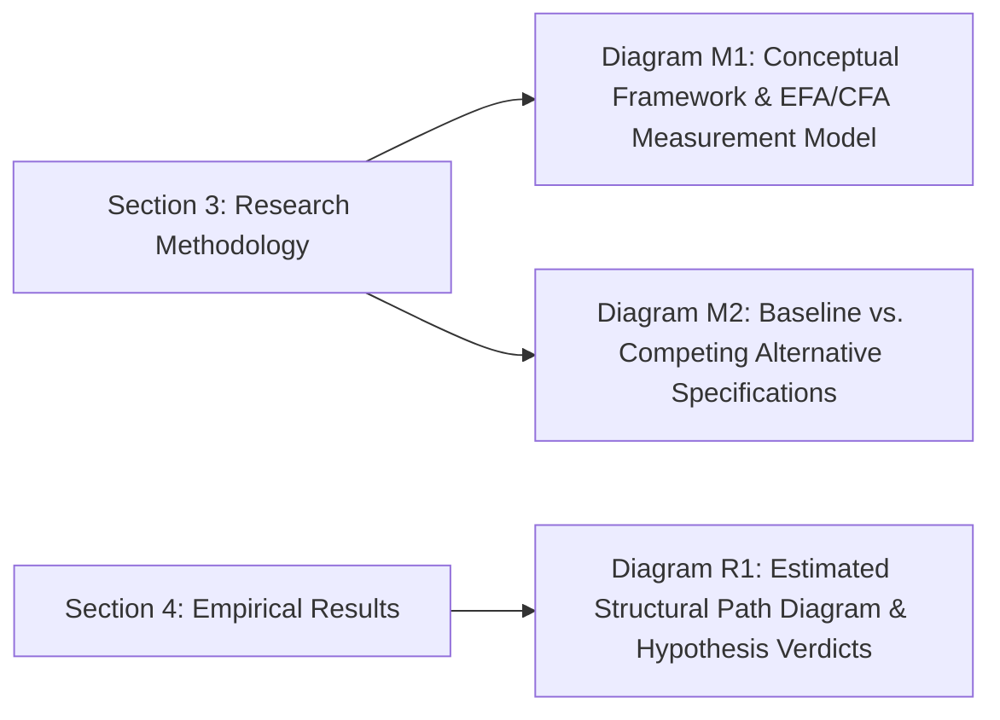

# Step-by-Step Guide: EFA/CFA/SEM/PLS-SEM Analysis, 3-Diagram 300-DPI Structural Models, and Bidirectional Citation Hyperlinks

This guide walks you step by step through conducting psychometric and structural equation studies (**EFA / CFA / SEM / PLS-SEM**), interpreting the **3-Diagram 300-DPI Measurement & Structural Model Suite**, and using **Bidirectional Citation Hyperlinks** and the **Smart Back-to-Top Progress Ring** across **EcoLab** and **EcoData**.

---

## 1. The 3-Diagram Measurement & Structural Model Suite (300 DPI)

Whenever your study involves Exploratory Factor Analysis (**EFA**), Confirmatory Factor Analysis (**CFA**), Covariance-Based Structural Equation Modeling (**CB-SEM**), or Partial Least Squares Structural Equation Modeling (**PLS-SEM**), the platform automatically renders and embeds **three 300-DPI academic diagrams** into the Methodology and Empirical Results sections:

### Diagram M1 (Section 3 — Methodology): Conceptual Framework & EFA/CFA Measurement Model
- **How to read the diagram:**
  - **Rectangular boxes (`X1..Xk`)** represent observed Likert survey indicators alongside their outer loading ranges $\lambda$.
  - **Ellipses** represent exogenous, mediating, moderating, and endogenous latent constructs with reliability badges ($lpha$, $	ext{CR}$, $	ext{AVE}$).
  - **Solid directed arrows (`H1..Hk`)** illustrate the hypothesized structural relationships prior to estimation.

### Diagram M2 (Section 3 — Methodology): Baseline vs. Competing Alternative Specifications
- **How to read the diagram:**
  - **Panel A (Left — Baseline Model):** Displays the direct-effects structural specification.
  - **Panel B (Right — Extended / Alternative Specification):** Displays the mediated, moderated ($X 	imes W$), or robust quantile ($	au = 0.50$) specification so readers can immediately compare model architectures.

### Diagram R1 (Section 4 — Empirical Results): Estimated Structural Path Diagram
- **How to read the diagram:**
  - Every structural branch displays the executed **baseline coefficient ($\hat{eta}_{	ext{base}}$)**, **competing model coefficient ($\hat{eta}_{	ext{alt}}$)**, **significance stars (`***`, `**`, `*`, `ns`)**, and **standard error (`SE`)**.
  - Supported hypotheses are drawn with **bold solid arrows**, while non-significant paths are drawn with **dashed arrows**.
  - The endogenous outcome ellipse displays **explained variance $R^2$**, **Adjusted $R^2$**, **$F$-statistic**, and **sample size $N$**.

---

## 2. How to Use Bidirectional In-Text Citation Hyperlinks

To help researchers, advisors, and peer reviewers verify scholarly sources without losing their reading place, every report and academic blog post features **two-way citation hyperlinks**:

1. **Step 1 — Click any in-text citation while reading:**
   - Click any parenthetical citation such as `(Hair et al., 2022)` or narrative citation such as `Fornell & Larcker (1981)` in Sections 1–5.
   - The page smoothly scrolls to the exact entry in **Section 6 (References)** and highlights the reference item with a warm gold pulse.
2. **Step 2 — Inspect the source via its clickable DOI link:**
   - Click the `https://doi.org/...` link inside the highlighted reference entry to open the original journal publication in a new tab.
3. **Step 3 — Jump right back to your reading position:**
   - Click the **`↩ Back to reading position`** button next to the reference entry in Section 6.
   - The view smoothly scrolls back to the exact sentence and inline citation you were reading and briefly highlights it.

---

## 3. Smart Back-to-Top Progress Ring & Reproducibility Appendix

- **Smart Back-to-Top Button with Progress Ring:** Once you scroll past the introduction, a floating button appears in the bottom-right corner displaying a live circular **reading progress ring (`0% – 100%`)**. Click it at any time to smooth-scroll back to the top of the manuscript.
- **One-Click `.csv` Dataset Download & Single-Row Mobile Code Switcher:** In the **Appendix**, download the exact UTF-8 `.csv` dataset and switch effortlessly between **R**, **Stata**, and **Python** replication scripts on a single compact row across mobile, tablet, and desktop screens.
