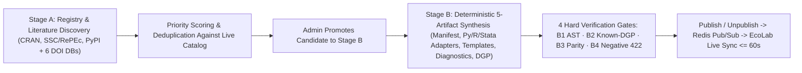

# Data Administration, Pipelines, and Two-Stage Econometrics Model Curation

This page is intended for EcoData administrators and platform engineers. Regular researchers do not need these steps to query indicators or run econometric estimations.

## Core Administration Modules

| Admin Module | Route / Protocol | Operational Responsibility |
| --- | --- | --- |
| **Admin Dashboard** | `/admin` | Monitor platform health, membership quotas, billing events, and background workers. |
| **Econometrics Model Curation** | `/admin/econometrics-curation` & `admin_econometrics_*` | Two-stage batch discovery, 5-artifact synthesis, 4-gate (`B1–B4`) Tri-Engine verification, and live `Publish` / `Unpublish` lifecycle management. |
| **GSO & 34-Province Admin** | `/admin` (GSO tab) | Ingest National Statistics Office tables, manage indicator aliases, and audit 34-province harmonized panels. |
| **Customs & Commodity Admin** | `/admin` (Customs tab) | Manage 11-form Vietnam Customs batches and five-sector Commodity Market feeds. |
| **Stock & Financials Admin** | `/admin` (Stocks tab) | Synchronize 30-year financial statements across four accounting regimes, notes, dividends, and corporate events. |
| **Translation & Metadata Jobs** | `/admin` (Translation tab) | Curate bilingual VI/EN variable labels, methodological descriptions, and SDMX metadata. |
| **Chat Providers & Export Queue** | `/admin` | Configure AI providers for Web Chat and monitor large-scale dataset export requests. |

---

## Two-Stage Batch Econometrics Model Discovery and Curation Pipeline

To keep the **201+ estimator catalog across 15 model families** aligned with peer-reviewed econometric advances without ever exposing mock or unverified wrappers in production, EcoData strictly separates **Stage A (Scholarly & Package Registry Discovery)** from **Stage B (5-Artifact Synthesis & 4-Gate Tri-Engine Verification)** at `/admin/econometrics-curation` (`/api/admin/econometrics/*`).

### 1. Stage A — Dual-Mode Discovery and Hybrid API Key Policy

- **Package & Scholarly Sources:** Harvests package metadata directly from **CRAN `PACKAGES.gz`** (Econometrics Task View), **Stata SSC / RePEc**, and **PyPI**, cross-referenced against six scholarly literature databases (**OpenAlex**, **Crossref**, **DOAJ**, **arXiv**, **Semantic Scholar**, and **CORE**).
- **Keyless-First Hybrid API Key Policy:**
  - **100% Keyless Default:** Stage A runs out-of-the-box across CRAN, Stata SSC/RePEc, PyPI, OpenAlex, Crossref, DOAJ, and arXiv without requiring any external API keys.
  - **Optional Encrypted Literature Keys:** Administrators may store **Fernet-encrypted** **Semantic Scholar** and **CORE** API keys in Admin Settings for higher scholarly rate limits.
  - **Zero Required LLM Keys for Stage B:** Stage B's 5-artifact synthesis relies on deterministic AST parsing and function-signature introspection (`inspect` / `formals`); Admin Web UI LLM assistance is strictly optional for bilingual docstring polishing, while all `/mcp*` endpoints enforce **`server_llm_calls == 0`**.

### 2. Stage B — Five Mandatory Artifacts and Four Hard Verification Gates (`B1–B4`)

Every promoted candidate must assemble **five mandatory artifacts**:
1. **Manifest Schema:** Canonical `estimator_key`, family assignment, required dependent/endogenous/instrument/cluster slots, and bilingual VI/EN labels.
2. **Tri-Engine Execution Adapters:** Genuine execution bindings across **Python**, **R (RMCP)**, and **Stata 18 MP** (with persistent SHA-256-locked `.ado` packages).
3. **Replication Script Templates:** Reproducible `.py`, `.R`, and `.do` code templates bundled into `.zip` exports with `SHA256SUMS.txt`.
4. **Pre/Postestimation Diagnostic Hooks:** Method-appropriate pre-estimation and postestimation statistical test bindings.
5. **Synthetic Known-DGP Benchmark Fixture:** Deterministic data-generating process with known ground-truth parameters.

The **`Publish`** action is hard-locked in both the backend API and Admin UI until all **four execution gates** pass on the real Tri-Engine:

| Gate | Verification Gate Name | Mandatory Pass Criterion |
| --- | --- | --- |
| **`B1`** | **AST & Command Safety Guard** | Rejects unsafe OS, network, filesystem, or shell-escape instructions across Python AST, R expressions, and Stata `.do` code. |
| **`B2`** | **Known-DGP Parameter Recovery** | Executes against the synthetic Known-DGP dataset and verifies estimated parameters recover ground-truth values within mathematical tolerance. |
| **`B3`** | **Cross-Engine Numerical Parity** | Cross-validates parameter signs, magnitudes, and standard-error structures across Python, R, and Stata 18 MP. |
| **`B4`** | **Negative `422` Fail-Closed Contract** | Confirms collinear, singular, or under-specified inputs return structured HTTP `422` errors with zero silent OLS fallback and zero `500` crashes. |

### 3. Five Admin MCP Tools and `<= 60s` Zero-Downtime Sync to EcoLab

Authenticated administrators can drive the entire curation workflow via five Admin-scoped MCP tools:
- `admin_econometrics_discover`: Launch a Stage A discovery batch filtered by topic or model family.
- `admin_econometrics_list_candidates`: List discovered candidates, priority scores, and `B1–B4` gate statuses.
- `admin_econometrics_synthesize_spec`: Synthesize the five standardized Stage B technical specification artifacts.
- `admin_econometrics_verify_gates`: Trigger real Tri-Engine execution across Gates `B1–B4`.
- `admin_econometrics_publish`: Publish a `4/4`-verified estimator into the live catalog or safely unpublish an estimator while preserving historical run readability.

Immediately upon **`Publish`** or **`Unpublish`**, EcoData broadcasts a Redis Pub/Sub catalog event, increments `catalog_version` on `GET /api/catalog/manifest`, and **EcoLab's** `CatalogHeartbeatService` refreshes its dynamic family tree and Unified MCP schemas within **`<= 60` seconds** without restarting any containers.

---

## Shared-Infrastructure Operating Principles

1. Never bypass Stage B `B1–B4` verification gates when registering new econometric estimators.
2. Always capture `0600`-permissioned `pg_dump` backups prior to database migrations.
3. On multi-tenant VPS infrastructure, verify `127.0.0.1` loopback bindings, Nginx upstreams, and container health before deployment; never run destructive `docker compose down` commands.
4. Run post-deployment smoke checks across Web UI, `/api/catalog/manifest`, EcoLab, and the Unified MCP Server after every release.
