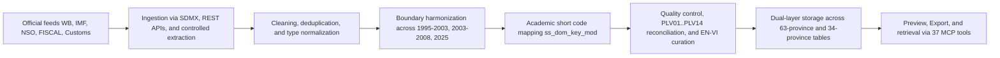

import Head from '@docusaurus/Head';

export const methodSchemaEn = {
  '@context': 'https://schema.org',
  '@type': 'TechArticle',
  '@id': 'https://docs.tnsai.vn/en/ecodata/du-lieu/methodology#article',
  headline: 'EcoData Data Methodology and Vietnam 34-Province Boundary Harmonization Algorithm 1995–2026',
  description:
    'Transparent documentation of how EcoData collects, cleans, maps academic short codes, harmonizes the 1995–2003, 2003–2008, and 2025 administrative boundary milestones across five econometric rules, and validates data quality.',
  url: 'https://docs.tnsai.vn/en/ecodata/du-lieu/methodology',
  inLanguage: ['vi', 'en'],
  author: { '@type': 'Organization', name: 'EcoData', url: 'https://ecodata.io.vn/' },
  publisher: { '@type': 'Organization', name: 'EcoData', url: 'https://ecodata.io.vn/' },
  about: [
    'data aggregation',
    'data cleaning',
    'Vietnam 63-to-34 provincial boundary harmonization',
    'SDMX metadata',
    'scientific reproducibility',
  ],
};

<Head>
  
</Head>

# Data Methodology and 34-Province Boundary Harmonization

EcoData does not fabricate primary statistics. The platform's role is to **aggregate, clean, harmonize across space and time, and attach rigorous metadata** from official statistical agencies into a unified panel and time-series schema ready for econometric estimation and peer-reviewed publication.

## End-to-End Data Processing Architecture

## 1. Multi-Source Data Ingestion and Seven Finco Subsystems

EcoData operates specialized ingestion pipelines tailored to each source family:
- **Standardized International APIs:** SDMX v2/v3 feeds for the IMF, Eurostat, OECD, and ILO; REST APIs for the World Bank, FAO, OWID, FRED, WTO, UNCTAD, and ADB; plus the **`MAIN_MARKET`** subsystem covering eight global focus regions.
- **Seven Specialized Vietnam Data Subsystems:**
  - **`NSO`:** 28 provincial PX-Web statistical tables and the 2024 Statistical Yearbook Appendices for 34 provinces coded `PLV01..PLV14`.
  - **`FISCAL`:** Ministry of Finance state budget outturn and estimate series coded `THUCHINS` from 1995 to 2026.
  - **`KTXH_GSO`:** Monthly, quarterly, and annual socio-economic reports from 2000 to 2026.
  - **`CUSTOMS`:** 11 official merchandise trade forms from Vietnam Customs: `1X`, `1N`, `2X`, `2N`, `3X`, `3N`, `4`, `5X`, `5N`, `HTX`, and `PTVT`.
  - **`SURVEY_INDEX`:** Seven provincial governance and institutional indices: `PCI`, `PGI`, `PAPI`, `PII`, `ICT Index`, `PAR Index`, and `SIPAS`.
  - **`COMMODITY_MARKET`:** Production, trade, consumption, and price series across five strategic commodity sectors and five analytical dimensions.
  - **`VN_34_REBUILD`:** Historical 34-province panel reconstruction engine covering 2000 to 2026.
- **Microdata and Capital Markets:** Multi-wave VHLSS household living standards microdata and 30-year corporate financial statements for over 1,600 listed firms across four Vietnamese accounting regimes.

## 2. Methodology for Three Vietnam Administrative Boundary Milestones From 1995 to 2026

To eliminate structural breaks in long provincial panels without altering historical records, EcoData enforces a strict **non-destructive dual-layer storage architecture**: all original 63-province tables remain 100% untouched, while harmonized 34-province series are computed into `vn_province_34_series` using the `vn_admin_units_34` mapping dictionary.

### Handling the 1995–2003 Milestone Under Resolution 22/2003/QH11

Effective January 1, 2004, Lai Chau split into Lai Chau and Dien Bien; Dak Lak split into Dak Lak and Dak Nong; and Can Tho split into Can Tho City and Hau Giang Province:
- **In 63-Province Mode:** EcoData backcasts 1995–2003 series using empirical three-year average share weights from 2004–2006 for each newly split province and indicator.
- **In 34-Province Mode:** Because Can Tho City, Hau Giang Province, and Soc Trang Province consolidated into the new Can Tho City under Resolution 202/2025/QH15, pre-2004 historical values for this cluster are summed directly with zero allocation error; the same principle applies where split provinces reconsolidate. Conversely, **Dien Bien** and **Lai Chau** remain two separate provinces in the 34-province catalog and therefore retain empirical 2004–2006 share weights for pre-2004 backcasting.

### Handling the 2003–2008 Milestone Under Resolution 15/2008/QH12

Effective August 1, 2008, all of Ha Tay Province, Me Linh District from Vinh Phuc Province, and four communes of Luong Son District from Hoa Binh Province merged into Hanoi Capital City:
- **Automated Backcast Detection:** EcoData inspects whether pre-2008 Hanoi series were already backcasted by the statistical agency to include Ha Tay. When backcasted values exist, EcoData retains the official expanded Hanoi figure and suppresses duplicate Ha Tay rows to prevent double-counting.
- **Metadata-Flagged Summation:** Where pre-2008 source tables report old Hanoi and Ha Tay separately, EcoData sums full Ha Tay figures into Hanoi and attaches metadata flags documenting district-level boundary approximations for Me Linh District and the four communes of Luong Son.

### Handling the 2025 Milestone Under Resolution 202/2025/QH15 and Five Mathematical Rules

Effective July 1, 2025, Vietnam consolidated 63 provinces into **34 provinces and cities** comprising 11 unchanged units and 23 consolidated units formed from 2 to 3 former provinces. EcoData applies **five mathematical aggregation rules** matched to each variable's economic nature:

| Rule Code | Mathematical Formula | Applicable Variable Classes |
| --- | --- | --- |
| **`sum`** | $Y_{P,t} = \sum_{i \in P} Y_{i,t}$ | Land area, average population, labor force, nominal GRDP, constant-price GRDP, total state budget revenue and expenditure `THUCHINS`, realized investment, merchandise export and import value. |
| **`weighted_mean`** | $R_{P,t} = \frac{\sum_{i \in P} R_{i,t} W_{i,t}}{\sum_{i \in P} W_{i,t}}$ | GRDP per capita, average monthly income, population density, poverty rate, unemployment rate, and urbanization rate using appropriate weights $W_{i,t}$ such as population, area, or labor force. |
| **`growth_constant_scale`** | $g_{P,t} = \left(\frac{\sum_{i \in P} Q_{i,t}}{\sum_{i \in P} Q_{i,t-1}} - 1\right) \times 100$ | Real GRDP growth rate and sectoral output growth rates recomputed from summed constant-price output $Q_{i,t}$. |
| **`index_chain`** | $I_{P,t} = \frac{\sum_{i \in P} I_{i,t} S_{i,t-1}}{\sum_{i \in P} S_{i,t-1}}$ | Consumer Price Index CPI and Industrial Production Index IIP weighted by retail sales of goods and services or industrial value added $S_{i,t-1}$. |
| **`non_aggregable`** | Preserve original observations with 34-province crosswalk keys | Pre-July 2025 institutional perception surveys including PCI, PAPI, PAR Index, and SIPAS as well as VHLSS household microdata records. |

All reconstructed 34-province series are reconciled against NSO Appendices `PLV01..PLV14` and 2025–2026 Socio-Economic Reports, achieving **99.5% or higher reconciliation accuracy**.

## 3. Academic Short Code Mapping and Quality Control

- **Academic Short Code System `ss_dom_key_mod`:** Every indicator receives a lowercase ASCII identifier up to 18 characters separated by underscores such as `wb_mac_gdp_usd`, and automatically generates three-tier LaTeX mathematical notation when loaded into econometric models.
- **Collapsible Primary Data Source Footnotes:** Every analytical panel includes a collapsible source footnote block displaying exact source badges such as `NSO`, `FISCAL`, `CUSTOMS`, and `GSO`, original measurement units, and applied harmonization rules.
- **Verified Bilingual Curation:** All indicator titles and units are curated across Vietnamese and English through a quality-controlled academic translation pipeline.

## 4. Scientific Reproducibility and Citation

Every exported workbook from EcoData includes a dedicated **Metadata** sheet documenting the academic short code, definition, measurement unit, issuing agency, and boundary mode across 63 or 34 provinces. Combined with the [Econometrics](/ecodata/cong-cu/econometrics) engine or `run_complete_econometric_study` via MCP, researchers obtain executable `.do`, `.R`, and `.py` scripts for 100% reproducible empirical research.

## See Also

- [Data Dictionary](/ecodata/du-lieu/data-dictionary)
- [GSO, NSO, and Vietnam 34-Province Statistics](/ecodata/indicators/gso-vietnam)
- [Data Source Groups and Seven Specialized Subsystems](/ecodata/nguon-du-lieu/phan-nhom-nguon-du-lieu)
