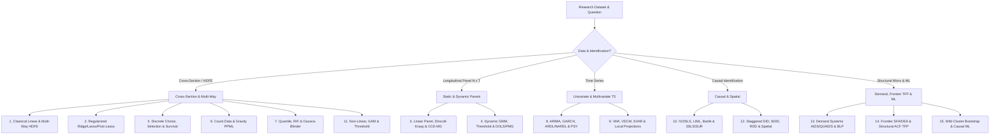
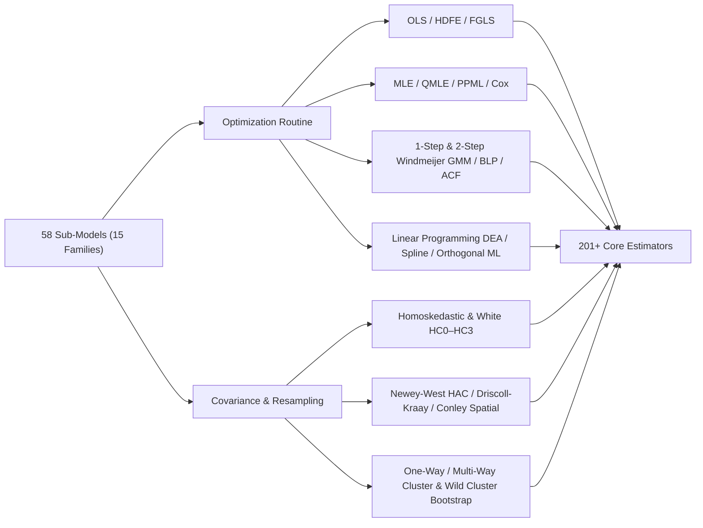

# Catalog of 15 Model Families, 58 Sub-Models & 201+ Estimators

EcoData (`v3.82.0`) and EcoLab (`v1.5.0`) share a unified Tri-Engine econometrics catalog comprising **15 major model families**, **58 mathematical sub-models**, and **201+ core estimators** executing natively across **Python**, **R**, and **Stata 18 MP**. Use this page as your methodological roadmap to match data structures and identification designs to the right estimator family.

:::tip Method-Accurate Execution & 100% Reproducibility
Every estimator executes its genuine econometric algorithm (strict Fail-Closed `422` enforcement with zero silent OLS fallback) and exports a `.zip` replication bundle containing Stata 18 MP (`.do`), R (`.R`), and Python (`.py`) scripts alongside `SHA256SUMS.txt`.
:::

---

## Decision Map Across the 15 Model Families

---

## Classification of 15 Model Families → 58 Sub-Models

| # | Model Family | Representative Sub-Models | When to Prioritize |
| :--- | :--- | :--- | :--- |
| 1 | **Classical Linear & Multi-Way HDFE** | [OLS](/ecolab/model/ols), [WLS](/ecolab/model/wls), [GLS](/ecolab/model/gls), [TLS](/ecolab/model/tls), Multi-Way HDFE | Baseline linear specifications or absorbing multi-way high-dimensional fixed effects |
| 2 | **Regularized Regression** | [Ridge](/ecolab/model/ridge), [Lasso](/ecolab/model/lasso), [Elastic Net](/ecolab/model/elastic-net), [Adaptive Lasso](/ecolab/model/adaptive-lasso), Post-Lasso | High-dimensional predictors, severe collinearity, and principled variable selection |
| 3 | **Linear Panel Data** | [Pooled OLS](/ecolab/model/pooled-ols), [Fixed/Random Effects](/ecolab/model/fem-rem), [Between](/ecolab/model/between), Mundlak CRE, Driscoll-Kraay, CCE-MG, PCSE | Multi-entity longitudinal panels controlling unobserved heterogeneity and cross-sectional dependence |
| 4 | **Dynamic, Threshold & Cointegrated Panel** | [Difference & System GMM](/ecolab/model/gmm), Dynamic Panel Threshold, Panel DOLS, FMOLS, PMG | Lagged dependent variables with endogenous regressors (large $N$, small $T$) or long-$T$ cointegrated panels |
| 5 | **Limited Dependent & Survival** | [Logit](/ecolab/model/logit), [Probit](/ecolab/model/probit), [Tobit](/ecolab/model/tobit), [Truncated](/ecolab/model/truncated), [Heckman](/ecolab/model/heckman), Fractional, Cox PH, Weibull AFT | Binary, multinomial, fractional $[0, 1]$, censored, sample-selected, or time-to-event duration outcomes |
| 6 | **Count Data & Gravity PPML** | [Poisson](/ecolab/model/poisson), [Negative Binomial](/ecolab/model/negbin), [ZIP](/ecolab/model/zip), [ZINB](/ecolab/model/zinb), Gravity PPML-HDFE | Non-negative integer counts, innovation patents, and bilateral trade gravity flows with zeros |
| 7 | **Quantile & Distributional Decomposition** | [Linear Quantile](/ecolab/model/quantile), [Panel MM-QR](/ecolab/model/panel-quantile), RIF Quantile, Oaxaca-Blinder | Heterogeneous effects across quantiles and counterfactual wage or productivity decompositions |
| 8 | **Univariate Time Series & Regime Switching** | [ARIMA](/ecolab/model/arima), [SARIMA](/ecolab/model/sarima), [GARCH](/ecolab/model/garch), [EGARCH](/ecolab/model/egarch), [ARDL](/ecolab/model/ardl), NARDL, Markov-Switching, PSY GSADF | Conditional volatility, mixed $I(0)/I(1)$ cointegration, asymmetric pass-through, and bubble detection |
| 9 | **Multivariate Time Series & Local Projections** | [VAR](/ecolab/model/var), [VECM](/ecolab/model/vecm), [SVAR](/ecolab/model/svar), Jordà Local Projections, IV-LP, Panel VAR | Multi-equation macro dynamics, structural shocks, and specification-robust impulse responses |
| 10 | **Instrumental Variables & Simultaneous Systems** | [IV/2SLS](/ecolab/model/iv-2sls), LIML, Lewbel IV, Bartik Shift-Share, [3SLS](/ecolab/model/3sls), [SUR](/ecolab/model/sur) | Endogenous regressors, weak instruments, shift-share exposure designs, and simultaneous systems |
| 11 | **Non-Linear, Semi-Parametric & Threshold** | [NLS](/ecolab/model/nls), [GAM](/ecolab/model/gam), Hansen Threshold, Robinson Semiparametric | Flexible non-linear curves and endogenous sample-splitting threshold regimes |
| 12 | **Causal Inference & Spatial Econometrics** | [TWFE & Staggered DID (CS, SA, BJS, SDID)](/ecolab/model/did), [PSM/AIPW](/ecolab/model/psm), [Sharp/Fuzzy RDD](/ecolab/model/rdd), Synthetic Control, Spatial SAR/SEM/SDM & Conley HAC | Staggered policy rollouts, synthetic counterfactuals, cutoff discontinuities, and spatial spillovers |
| 13 | **Structural IO & Demand Systems** | [AIDS, QUAIDS, Berry Logit IV & Random-Coefficients BLP](/ecolab/model/demand-systems-blp) | Price and expenditure elasticities in consumer demand systems and differentiated-product markets |
| 14 | **Productivity, Frontier & TFP Estimation** | [SFA, DEA, Malmquist, Olley-Pakes, Levinsohn-Petrin, Wooldridge & ACF TFP](/ecolab/model/frontier-tfp-decomposition) | Technical efficiency benchmarking and structural firm-level total factor productivity estimation |
| 15 | **Resampling, Econometric ML & High-Dimensional Inference** | [Wild Cluster Bootstrap, Double/Debiased ML, Causal Forest & PCA/Factor](/ecolab/model/bootstrap-highdim-inference) | Reliable inference under few clusters ($G < 30$), high-dimensional nuisance controls, and CATE |

---

## How Are the 201+ Core Estimators Formed?

The **58 mathematical sub-models** capture distinct structural equations. Pairing each sub-model with its appropriate optimization routine and variance-covariance / resampling estimator yields **201+ core estimators** (continuously extensible via EcoData's 2-stage `B1–B4` curation pipeline):

---

## Separated Pre-Estimation and Postestimation Diagnostic Matrix

| Diagnostic Phase | Representative Statistical Tests | Role in Peer-Reviewed Manuscripts |
| :--- | :--- | :--- |
| **Pre-Estimation Diagnostics** | ADF, PP, KPSS, IPS, LLC, Pesaran CIPS; $VIF$; Pesaran CD; Moran's $I$; Pedroni, Kao, Westerlund, Johansen | Establishes stationarity orders, screens collinearity, and verifies spatial/cross-sectional dependence and cointegration prior to model selection |
| **Postestimation Diagnostics** | Breusch-Pagan, White, Wooldridge, Ramsey RESET, Hausman/Mundlak, AR(1)/AR(2), Hansen $J$, Kleibergen-Paap rk Wald $F$, Bounds $F/t$, Event-Study Pre-Trend, McCrary | Validates residual assumptions, instrument relevance/exogeneity, parallel pre-trends, and statistical inference reliability |

---

## See Also

- [Econometrics Estimation & Modeling](/ecolab/econometrics-modeling) — complete operational workflow in EcoLab
- Newly expanded model families: [Demand Systems & BLP (Family 13)](/ecolab/model/demand-systems-blp) · [Frontier & TFP Estimation (Family 14)](/ecolab/model/frontier-tfp-decomposition) · [Wild Cluster Bootstrap & Causal ML (Family 15)](/ecolab/model/bootstrap-highdim-inference)
- Core family guides: [Panel Data (FEM/REM)](/ecolab/model/fem-rem) · [Dynamic Panel (GMM)](/ecolab/model/gmm) · [ARDL](/ecolab/model/ardl) · [VECM](/ecolab/model/vecm) · [DID](/ecolab/model/did)
