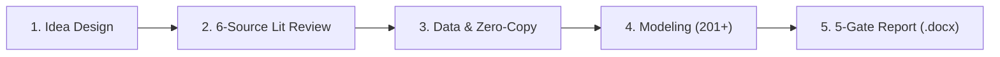

# EcoLab Overview

**EcoLab** (version `v1.5.0`) is an end-to-end quantitative economics research workspace engineered to streamline the entire scholarly lifecycle — from research design and DOI-verified literature synthesis to standardized dataset preparation, Tri-Engine econometric estimation, and publication-ready manuscript generation.

Connected directly to the **EcoData Tri-Engine** (**Python**, **R**, and **Stata 18 MP**), EcoLab exposes a dynamically synchronized catalog of **201+ core estimators across 15 model families and 58 sub-models**, accessible both in the interactive web studio and through the **Unified 52-Tool EcoData MCP (`https://ecodata.io.vn/mcp`)** and **Direct 15-Tool EcoLab MCP (`https://ecolab.io.vn/mcp`)** gateways.

---

## 1. Academic Architecture and Core Capabilities

EcoLab is built around methodological transparency, 100% computational reproducibility, and zero statistical hallucination:

| Research Pillar | Core Capability | Scholarly Value Delivered |
| :--- | :--- | :--- |
| **6-Source Literature Synthesis** | OpenAlex, Crossref, DOAJ, and arXiv out-of-the-box, plus encrypted personal keys for Semantic Scholar and CORE | Every citation is anchored to a Verified Citation Ledger entry backed by an authentic DOI or primary scholarly identifier. |
| **Zero-Copy EcoData Data Bridge** | Seamless transfer of global macro indicators, Vietnam 34/63-province panels, 30-year corporate financials, and VHLSS/PCI microdata | Eliminates manual spreadsheet merging errors while preserving bilingual variable labels and primary source provenance. |
| **201+ Econometric Estimators** | 15 model families and 58 sub-models executing on Python, R, and Stata 18 MP with `<= 60s` automatic catalog sync | Separates Pre-Estimation and Postestimation diagnostics, enforces Fail-Closed `422` integrity (zero silent OLS fallback), and exports `.zip` replication bundles (`SHA256SUMS.txt`). |
| **5-Gate Evidence-Locked Manuscripts** | Dual **Standard IMRaD** and multi-perspective **STORM** authoring across 5 citation styles (APA 7th, Chicago, Harvard, IEEE, MLA) | Locks every reported coefficient, standard error, $p$-value, 300-DPI PNG figure, and native Word OMML `.docx` equation to verified estimation artifacts. |
| **Dual MCP Ecosystem (`server_llm_calls == 0`)** | 52 unified tools at `https://ecodata.io.vn/mcp` or 15 direct tools at `https://ecolab.io.vn/mcp` | Connects cleanly to Gemini Task/Gems, AntiGravity, Claude Code, OpenAI Codex, and Cursor IDE with zero server-side LLM quota dependency. |

---

## 2. Target Audience

EcoLab accelerates rigorous empirical research across the academic and policy community:

- **Graduate Students & PhD Candidates:** Structure theses and dissertations in economics, corporate finance, international trade, and public policy to international peer-reviewed standards.
- **University Faculty:** Rapidly prototype empirical strategies, validate identification assumptions on real datasets, and supervise students using transparent `.do`, `.R`, and `.py` replication bundles.
- **Researchers & Policy Analysts:** Conduct staggered policy evaluations (Callaway-Sant'Anna DID, SDID, Synthetic Control, RDD), productivity benchmarks (SFA/DEA/ACF TFP), and structural demand analyses (QUAIDS/BLP) with full diagnostic auditability.

---

## 3. Closed-Loop 5-Stage Research Pipeline

To guarantee scientific coherence, EcoLab organizes every study into a five-stage pipeline where hypotheses, variable dictionaries, and empirical artifacts flow seamlessly from stage to stage:

1. **Idea Generation:** Formulate, score, and refine empirical research questions and causal identification designs from topics or seed papers.
2. **Literature Review:** Query six scholarly databases simultaneously, construct structured literature matrices, isolate research gaps, formalize $H_0 / H_1$ hypotheses, and propose empirical variable frameworks.
3. **Data Collection & Diagnostics:** Ingest datasets Zero-Copy from EcoData (or upload local CSV/Excel/Stata files), inspect summary statistics and correlation matrices, and run **Pre-Estimation Diagnostics**.
4. **Econometric Modeling:** Estimate **201+ core estimators across 15 model families** on Python, R, and Stata 18 MP, audit **Postestimation Diagnostics**, run robustness specifications, and export `.zip` replication bundles (`SHA256SUMS.txt`).
5. **Research Report:** Author **Standard IMRaD** or **STORM** manuscripts verified through five evidence-locking gates, exporting native Word OMML `.docx`, 300-DPI PNG figures, LaTeX, Markdown, and HTML.
