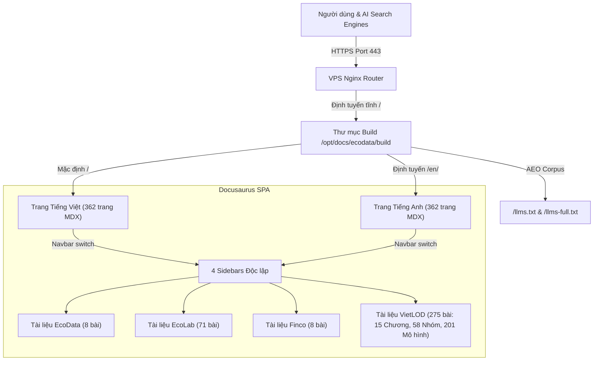

# architecture-map.md - Bản đồ Kiến trúc Trang Tài liệu

Tài liệu này mô tả kiến trúc kỹ thuật của cổng tài liệu hướng dẫn dùng chung `docs.tnsai.vn` tích hợp 4 ứng dụng cốt lõi trong hệ sinh thái TNS AI: **EcoData**, **EcoLab**, **Finco** và **VietLOD**.

---

## 1. Tổng quan Kiến trúc (System Overview)

Cổng tài liệu được xây dựng dưới dạng một trang web tĩnh (SPA) sử dụng framework **Docusaurus v3**. Trang web được biên dịch tĩnh theo cơ chế nguyên tử không gián đoạn (Zero-Downtime Atomic Build: `build_staging` $\to$ `build`) và phục vụ trực tiếp bằng **Nginx** thông qua giao thức HTTPS, kèm xuất chỉ mục AEO `/llms.txt` và `/llms-full.txt`.

---

## 2. Kiến trúc Thư mục và Phân bổ Tài liệu

Dự án sử dụng **1 Instance tài liệu duy nhất** chia thư mục con trong `docs/` để cô lập nội dung và quản lý sidebars thông qua tệp cấu hình trung tâm:

*   **[`/docusaurus.config.js`](file:///d:/docs/docusaurus.config.js)**: Chứa cấu hình chung của site (domain, locales `vi`/`en`, navbar items, themes, JSON-LD `WebSite`/`SoftwareApplication`, `docusaurus-plugin-llms`, `[rehypeKatex, { strict: false }]`).
*   **[`/sidebars.js`](file:///d:/docs/sidebars.js)**: Định nghĩa 4 sidebars tương ứng với 4 ứng dụng (`ecodataSidebar`, `ecolabSidebar`, `fincoSidebar`, `vietlodSidebar`). Mỗi sidebar bắt đầu bằng trang tổng quan tương ứng (`ecodata/overview`, `ecolab/overview`, `finco/overview`, `vietlod/overview`).
*   **Thư mục tài liệu gốc (Tiếng Việt - Mặc định)**:
    *   [`docs/ecodata/`](file:///d:/docs/docs/ecodata/): Tài liệu hướng dẫn sử dụng EcoData (`8` tệp `.mdx`).
    *   [`docs/ecolab/`](file:///d:/docs/docs/ecolab/): Tài liệu hướng dẫn sử dụng EcoLab (`71` tệp `.mdx`).
    *   [`docs/finco/`](file:///d:/docs/docs/finco/): Tài liệu hướng dẫn sử dụng Finco & StockMCP (`8` tệp `.mdx`).
    *   [`docs/vietlod/`](file:///d:/docs/docs/vietlod/): Tài liệu hướng dẫn sử dụng VietLOD (`275` tệp `.mdx`: 1 Tổng quan + 15 Chương + 58 Nhóm + 201 Mô hình).
*   **Thư mục bản dịch (Tiếng Anh - i18n)**:
    *   [`i18n/en/docusaurus-plugin-content-docs/current/`](file:///d:/docs/i18n/en/docusaurus-plugin-content-docs/current/): Chứa các thư mục con bản dịch đối xứng 1:1 (`ecodata/`, `ecolab/`, `finco/`, `vietlod/`).
    *   [`i18n/en/docusaurus-plugin-content-docs/current.json`](file:///d:/docs/i18n/en/docusaurus-plugin-content-docs/current.json): Chứa bản dịch tiếng Anh cho nhãn sidebar và cấu trúc danh mục.

---

## 3. Cơ chế Chuyển đổi Sidebars động (Sidebar Switching Flow)

Để mang lại trải nghiệm học thuật chuyên nghiệp, trang tài liệu cô lập sidebar của từng ứng dụng. Việc chuyển đổi được thực hiện tự động thông qua thuộc tính `type: 'docSidebar'` trên Navbar:
1.  Người dùng bấm vào liên kết ứng dụng trên Navbar (`EcoData`, `EcoLab`, `Finco`, hoặc `VietLOD`).
2.  Docusaurus trỏ tới trang overview tương ứng của ứng dụng (`/ecodata/overview`, `/ecolab/overview`, `/finco/overview`, `/vietlod/overview`).
3.  Hệ thống nhận diện trang này thuộc sidebar riêng của ứng dụng đó và chuyển đổi thanh điều hướng bên trái tương ứng.
4.  Tất cả các Sidebars đều bắt đầu bằng danh mục **"Bắt đầu"** (`Getting Started`) để giới thiệu tổng quan kiến trúc và quy trình khai thác nhanh.
